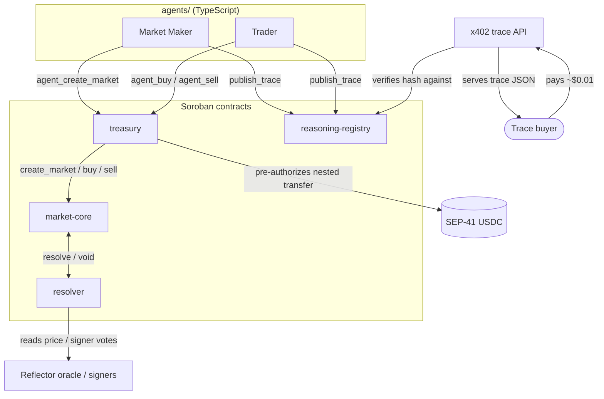

# CodeNomad (Stellar backend)

**Status: testnet only · unaudited · pre-alpha**

CodeNomad is an autonomous prediction-market system: a Market Maker agent
seeds markets from signals it observes, a Trader agent trades mispricings
against a fair-value estimate, and every decision either agent makes is
hashed and recorded on-chain before it acts — so a subscriber can pay about
$0.01 (via [x402](https://x402.org)) to read the exact reasoning behind a
trade and check it against the on-chain hash, rather than trusting the
agent's word for it.

This is the Stellar/Soroban native port of the system originally built for
the Agora Hackathon on Arc + Polygon (Solidity, Polymarket execution, Circle
CCTP/Wallets). None of that Arc-era execution stack is part of this repo —
markets, trading, resolution, the reasoning registry, and the agent treasury
are all native Soroban contracts, collateralized in a SEP-41 USDC token.
Polymarket survives only as an optional, execution-free reference price an
agent's strategy may read (see `agents/core/strategy.ts`).

## Architecture



Design decisions with real trade-offs are written up in `docs/adr/`:

- [0001: resolution commitment](docs/adr/0001-resolution-commitment.md) — why
  a market commits to its resolution rule at creation, before trading opens.
- [0002: cross-contract calls](docs/adr/0002-cross-contract-calls.md) — why
  `resolver`/`treasury` generate a client from `market-core`'s compiled wasm
  instead of a normal Cargo dependency (the latter breaks the wasm build).

## Prerequisites

- Rust (stable) with the `wasm32v1-none` target — `rust-toolchain.toml`
  pins this for you if you use `rustup`.
- The [Stellar CLI](https://developers.stellar.org/docs/tools/cli) (`stellar`), v27+.
- Node.js 22+ and npm.
- Python 3.10+ (for `model/fpmm_model.py`'s property tests).
- `jq` (used by the deploy/seed scripts).

## Quickstart

```bash
make setup          # npm install in x402/, agents/, packages/bindings/*
make build           # cargo build + stellar contract build for all 4 contracts
make test            # cargo test, model/fpmm_model.py, x402 tests
make lint            # cargo fmt --check + clippy -D warnings
make deploy-testnet   # idempotent: generates/funds testnet identities,
                      # deploys all 4 contracts + a self-issued test USDC,
                      # wires them together, writes deployments/testnet.json
make demo            # create -> trade -> resolve -> record trace -> verify hash,
                      # entirely on testnet, with real transaction output
make e2e-local       # hermetic quickstart run: deploy, both resolution modes,
                      # live trader, x402 trace fetch (Docker required)
make model-test      # Python stateful model selftest + proptest-vs-wasm harness
```

`make deploy-testnet` and `make demo` submit real Stellar testnet
transactions using two throwaway identities (`oracledesk-deployer`,
`oracledesk-agent`) that `scripts/deploy-testnet.sh` generates and funds via
`stellar keys generate --fund`. Nothing here ever touches mainnet.

### Local end-to-end harness

`NETWORK=local` is a first-class target for the deploy, seed and demo scripts.
`scripts/e2e-local.sh` starts the Stellar quickstart container, registers the
`local` network, deploys the contracts plus the local-only
`contracts/test-oracle`, and then verifies:

1. signer-mode resolution through the resolver;
2. price-mode resolution through the deployed test oracle;
3. a live TypeScript trader opening a position through the treasury;
4. an x402 registry lookup whose trace hash is verified on-chain.

It is hermetic and never talks to testnet or mainnet. Deployment records are
kept per network (`deployments/testnet.json`, `deployments/local.json`), so a
local run cannot clobber testnet addresses. The local agent environment can be
selected with `DEPLOYMENTS_PATH=deployments/local.json`.

The fake oracle is deliberately absent from the testnet deploy path; do not
pass it to a production deployment.

## Treasury migration

The treasury has no upgrade path or config setters — fixing a bug, changing
caps, or rotating the agent means deploying a **new** treasury. Deploying
one strands nothing: the old treasury's positions and LP ownership can be
handed to a successor market by market:

```bash
make build                        # treasury wasm must be current
scripts/migrate-treasury.sh      # deploys a successor + migrates every market
```

The script reads `deployments/testnet.json` and the old treasury's live
config, deploys a new treasury with the same agent/collateral/caps, records
it as the old treasury's successor (`set_successor`, admin), then calls
`migrate_market(i)` for every `i` in `0..market_count`. Both steps are
admin-gated — the agent cannot invoke them — and the destination is fixed
to the recorded successor, so migration cannot send value anywhere else.
Re-running is safe. It deliberately does **not** rewire market-core
(`propose_treasury` + the treasury's `accept_market_core_role`); that cutover
changes the fee recipient for future markets
and stays a separate operator step (the script prints the exact commands).
See `docs/architecture.md` for the full auth model.

## Incident & recovery runbook

This runbook covers the two live services — the **agents** (`agents/`, the
Market Maker and Trader CLIs) and the **payment/trace API** (`x402/`) — plus
the Soroban contracts they drive. It is written for testnet operators; the
same steps apply to any future deployment. Read `docs/STATUS.md` first: it is
the honest account of what is verified.

Guiding rule: **never present unverified state as live.** If a step below
cannot confirm on-chain state, stop and escalate rather than guessing or
silently falling back.

### 1. Containment

Goal: stop new value-moving actions while preserving evidence.

1. **Stop the agents.** Kill the Market Maker and Trader processes (or scale
their deployment to zero). Agents are the only components that sign
`agent_create_market` / `agent_buy` / `agent_sell`; stopping them halts new
orders immediately. Do not delete their logs or working directories.
2. **Pause the payment API.** Stop the `x402/` service so it stops serving
traces and accepting payment. A stopped API fails closed — buyers get an
error, not stale or fabricated data.
3. **Preserve evidence before touching anything else.** Copy, do not move:
   - agent stdout/stderr logs and any local state files;
   - the x402 service logs and the request IDs of in-flight payments;
   - `deployments/<network>.json` (the addresses in force at incident time);
   - the transaction hashes of every action taken in the incident window
     (from the agent logs and from a Stellar explorer / Horizon query).
4. **Do not** run `migrate-treasury.sh`, rotate keys, or redeploy contracts
   during containment. Those are recovery steps (§3–§5) and change state you
   may still need to inspect.

### 2. Pausing

There is no global on-chain pause switch; pausing is done by stopping the
services that act.

- **Agents:** stopping the processes is the pause. Because every action is a
  signed transaction, a stopped agent cannot move funds. Confirm no agent
  process is running before declaring the system paused.
- **Payment API:** stopping the `x402/` service pauses paid trace delivery.
  The reasoning registry is unaffected — published traces remain on-chain and
  verifiable; only the paid read path is down.
- **Contracts:** market-core, resolver, treasury and reasoning-registry have
  no pause entrypoint. To stop a misbehaving treasury from acting, stop the
  agent (the only signer) and, if needed, proceed to treasury migration (§5).
- **Resuming:** only after the root cause is understood and §4 reconciliation
  is complete. Restart the payment API first (it is read-only against the
  registry), verify a known trace hash resolves, then restart agents one at a
  time and watch the first few transactions before leaving them unattended.

### 3. Key rotation

The agent identity (`oracledesk-agent`) is the key that signs trades. Rotate
it if it may be compromised.

1. **Contain first** (§1): stop the agents so the old key cannot sign.
2. **Generate a new identity** with `stellar keys generate <new-name> --fund`
   (testnet) or your normal key-provisioning flow. Never reuse the old seed.
3. **Point the treasury at the new agent.** The treasury stores its agent
   address; changing it requires a **new treasury** (there are no config
   setters). Follow the treasury migration in §5, deploying the successor
   with the new agent address.
4. **Retire the old key:** remove it from the agent environment and from any
   secret store. Record the rotation (old address, new address, time,
   transaction hashes) in the incident log.
5. **Deployer/admin key:** the deployer identity is admin-gated for
   `set_successor` / `migrate_market` and market-core rewiring. Rotating it
   means re-running the admin steps with the new key; treat it with the same
   contain-then-rotate discipline and never rotate it mid-migration.

### 4. Uncertain transactions & payment reconciliation

An "uncertain" transaction is one where the client did not observe a
success/failure result — a timeout, a dropped connection, or a crash after
submission. **Never assume it failed and blindly retry**; a retry can double a
trade or double-charge a buyer.

Decision points for an uncertain agent transaction:

1. **Look it up on-chain.** Query the transaction hash (from the agent log)
   against Horizon / the explorer. Outcomes:
   - **Confirmed success** → record it; do not retry. Reconcile the position
     against the treasury/market state.
   - **Confirmed failure** → safe to retry once the cause is fixed.
   - **Not found / still pending** → wait for ledger close and re-query. Do
     not resubmit until you have a definitive answer or the transaction has
     provably expired.
2. **If no hash was captured** (crash before logging), reconstruct from the
   agent's account sequence number and recent operations on Horizon before
   taking any new action.
3. **Reconcile balances** against the treasury's on-chain positions and the
   SEP-41 USDC balance; the chain is the source of truth, not local state.

Payment (x402) reconciliation:

1. A buyer's payment is only "settled" if the trace hash verifies against the
   reasoning registry on-chain. If verification fails, the payment must be
   treated as **unsettled** — do not serve the trace, do not mark it paid.
2. For an in-flight payment interrupted by the pause, look up its settlement
   transaction the same way as §4.1. Refund or re-serve only after the
   on-chain outcome is known.
3. Never serve sample or cached trace data as if it were a live, verified
   trace. A failed verification is an error to the buyer, not a fallback.

### 5. State restore & service resumption

1. **Restore configuration from the preserved `deployments/<network>.json`**
   (§1.3). Do not hand-edit addresses; if the file is lost, recover addresses
   from the deploy transaction history before proceeding.
2. **Treasury recovery:** if the treasury must be replaced (bug, cap change,
   or key rotation), run `scripts/migrate-treasury.sh` per the Treasury
   migration section. It is admin-gated, idempotent, and sends value only to
   the recorded successor. Verify each `migrate_market` succeeded before
   declaring recovery complete.
3. **Market-core rewiring** (fee recipient cutover) is a separate, deliberate
   operator step — run the commands the migration script prints only after
   the successor treasury is verified.
4. **Resume services** in the order from §2: payment API, verify a known trace
   hash, then agents one at a time.
5. **Verify before declaring resolved:** a fresh `make demo` (or the
   `make e2e-local` harness for a hermetic check) should pass end to end, and
   the reconciled balances from §4 should match on-chain state.

### Operator verification checklist

- [ ] Agents stopped; no agent process signing.
- [ ] Payment API stopped; buyers receive errors, not stale data.
- [ ] Logs, `deployments/<network>.json`, and incident-window tx hashes
      preserved (copied, not moved).
- [ ] Every uncertain transaction resolved on-chain before any retry.
- [ ] Any key rotation recorded with old/new addresses and tx hashes.
- [ ] Treasury migration (if any) verified market by market.
- [ ] Services resumed in order; a known trace hash verifies; `make demo`
      or `make e2e-local` passes.

## Repository layout

```
contracts/            market-core, resolver, treasury, reasoning-registry,
                      test-oracle (local E2E only), integration-tests
model/fpmm_model.py   Python mirror of the FPMM math, property-tested
model/system_model.py stateful four-contract model, replayed against wasm
x402/                 the paid trace API (Express + @x402/*)
agents/               core/ (chain-agnostic strategy + trace building),
                      stellar/ (signing/submission adapter), bin/ (CLIs)
packages/bindings/    generated TypeScript contract clients
scripts/              deploy-testnet.sh (NETWORK=testnet|local),
                      migrate-treasury.sh, seed-market.sh, demo.sh,
                      e2e-local.sh, gen-bindings.sh, spec-hash/
deployments/          testnet.json — the current live testnet addresses
docs/                 architecture, ADRs, frontend-integration, STATUS
```

## Contributing

See [CONTRIBUTING.md](CONTRIBUTING.md) for dev setup, branch/commit
conventions, and how issues are scoped. Issues seeded for the
[Drips Stellar Wave Program](https://drips.network) live as files in
`docs/wave-issues/` before they're filed.

## Status

`docs/STATUS.md` is the honest, current account of what's verified, what's
unverified, and what's left — read it before assuming any given piece works
end to end.

## License

[MIT](LICENSE)
